#  Nexa

<!-- markdownlint-disable MD013 MD033 -->

> Nexa shows workers which of their tasks AI is already doing, which skills carry them forward, and a cited path to their next role, and gives HR the same view for the whole workforce.

**AI takes tasks, not people.** Nexa forecasts at the level of **tasks**, not
job titles, in **three possible futures**, with **every number cited and
dated**, and maps every pathway to the **UN Sustainable Development Goals**.

**Live:** [nexa-xxx.vercel.app](https://nexa-xxx.vercel.app/) · **Video:** [youtu.be/dp5byv_Zbzo](https://youtu.be/dp5byv_Zbzo) · **Slides:** [Pitch deck](https://drive.google.com/file/d/1aasnv7n8EIVwiowdyzulz0QttzTl282e/view?usp=sharing) · **Team EcoByte** · SDC Hackathon 2026

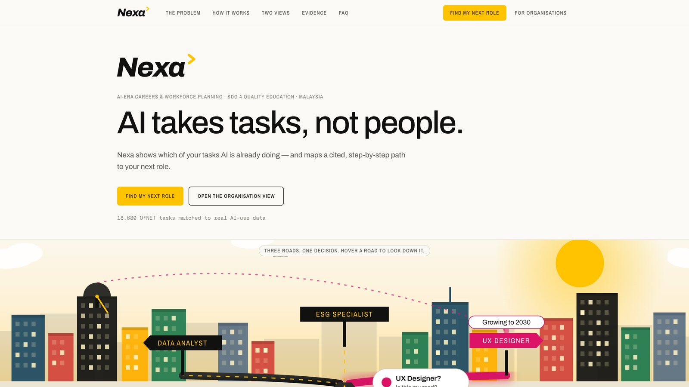

*The landing page at [nexa-xxx.vercel.app](https://nexa-xxx.vercel.app/):
the problem, how it works, the two views and the evidence behind every number.*

---

## 📋 Team Information

| Field | Details |
| --- | --- |
| **Team Name** | EcoByte |
| **Team Domain** | Domain 1 — Aiversecity Future-Ready Workforce |
| **SDG Track (1–17)** | SDG 4 — Quality Education (Target 4.4), with SDG 5, 8, 9 and 10 |
| **Team Leader** | Eya Hia |
| **University** | Lincoln University College · UKM · UTM · Universiti Malaysia Kelantan |
| **Number of Members** | 4 |

## 🔗 Links

| Resource | Link |
| --- | --- |
| GitHub Repository | https://github.com/eyahia1712/Nexa |
| Replit Project | Team workspace on Replit (ideation and pitch deck) · proof: [`submission/SDC2026_EcoByte_Replit_POU.pdf`](submission/SDC2026_EcoByte_Replit_POU.pdf) |
| Live Demo | https://nexa-xxx.vercel.app/ |
| RunPod Endpoint | RunPod Serverless endpoint (ID kept private in environment variables) · proof: [`submission/SDC2026_EcoByte_Runpod_POU.pdf`](submission/SDC2026_EcoByte_Runpod_POU.pdf) |
| Slide Deck | https://drive.google.com/file/d/1aasnv7n8EIVwiowdyzulz0QttzTl282e/view?usp=sharing · PDF copy: [`docs/Nexa_Pitch_Deck.pdf`](docs/Nexa_Pitch_Deck.pdf) |
| Demo Video | https://youtu.be/dp5byv_Zbzo |

---

## 💡 Overview

### Problem

- **56%** of Malaysian professionals already use AI at work; only **26%** have been trained for it (Hays Asia Salary Guide 2025)
- **600,000+** Malaysian workers need reskilling in the next three to five years (MOSTI, cited in the SDC brief)
- Forecasts talk about **job titles**, but AI takes over **tasks**, so nobody gets a personal answer
- Course lists and career advice are **out of date** the quarter they are published
- HR teams still plan reskilling with **spreadsheets and guesswork**

**Everyone can see the storm coming. Nobody has a personal forecast, or a road out.**

### Solution

<picture>
  <source media="(prefers-color-scheme: dark)" srcset="docs/diagrams/journey-dark.png">
  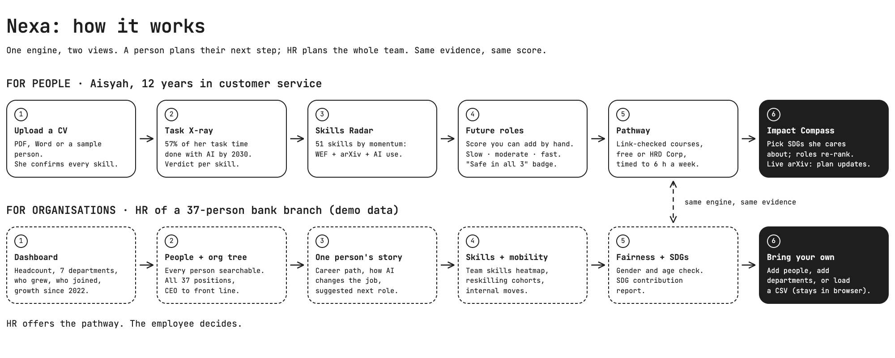
</picture>

#### 📄 1. Upload a CV

- Drop a **PDF or Word CV**, fill a short form, or pick a **synthetic sample person**
- Nexa reads the **name, job and skills**; the person **confirms every skill** before anything is scored
- No account, no database: the profile **stays in the browser**

**The person is in charge of their own profile from the first second.**


#### 🔬 2. Task X-ray

- The job is broken into its **official O\*NET tasks** (18,838 tasks across the catalogue)
- Each task is checked against **measured real-world AI use** (Anthropic Economic Index, 18,680 tasks matched)
- Result: the share of **this person's task time** done with AI by 2030, as a **range**, plus a clear **verdict for every skill** (for example *future-proof*: rising, and AI can't do it for you)

**Forecasts at the level of tasks, not job titles.**


#### 📡 3. Skills Radar

- **51 skills** plotted by **Skill Momentum**, one 0–100 number per skill
- Built from three named pieces of evidence: **WEF Future of Jobs 2025**, **live arXiv research growth** and **AI substitution pressure**
- Tap any skill: the **"Why?" panel** shows every point and its source

**Every score is explained, with sources.**


#### 🎯 4. Future roles, in three futures

- **21 cited roles** ranked with a score you can **add up by hand** (skills + transferable + demand − entry barrier)
- Every role shows the **exact skills gap** and the **weeks to get ready**
- Every forecast runs in **slow, moderate and fast** disruption; roles on top in all three get a **"safe in all 3 futures"** badge

**No single prediction. No black box.**


#### 🛣️ 5. A pathway to start today

- Prerequisites first, then a **week-by-week plan** timed to the hours the person has (for example **6 hours a week, about 5 weeks**)
- **56 real, link-checked courses**, free or claimable through **HRD Corp**
- **Impact Compass:** pick up to 3 SDGs you care about, and roles **re-rank ▲▼** in front of you

**Nothing invented: 0 made-up jobs or courses.**


#### 🔄 6. When the evidence moves, the plan moves

- **Refresh signals** queries **arXiv** and **OpenDOSM** live
- Two **dated real readings** ship with the app, so the change is visible even offline
- **What changed** explains, in plain words, which roles moved and why

**A plan that ages with the evidence, not against it.**

<p align="center">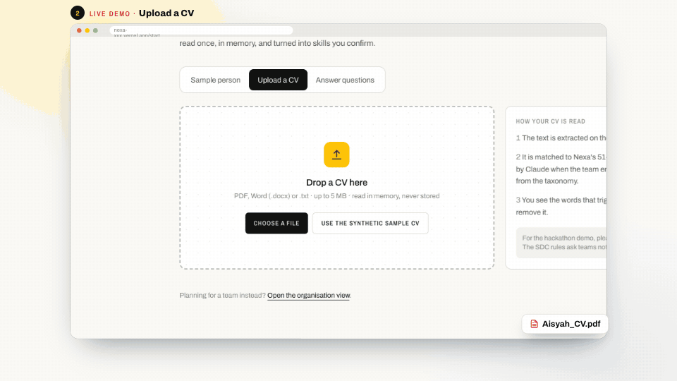</p>

*Aisyah's journey, live: CV review, her dashboard (57% of her work changes with
AI), future roles in three futures, and her pathway.*


#### 🏢 7. For organisations

The same engine, one level up. The demo organisation is a **37-person bank
branch** with invented staff, labelled on screen as demo data.

- **Dashboard:** headcount, 7 departments, **19 people who grew into a new role**, 20 who joined fresh, growth since 2022
- **People + org tree:** every person searchable; all **37 positions, CEO to front line**, on one screen
- **One person's story:** career path, **how AI changes their job**, a suggested next role; **HR offers the pathway, the employee decides**
- **Team skills, reskilling cohorts, talent mobility**, a **fairness check** across gender and age, and an **SDG report**
- **Bring your own data:** add people and departments, or **load a CSV** (read in the browser only, never uploaded)

**HR plans growth, not cuts.**

<p align="center">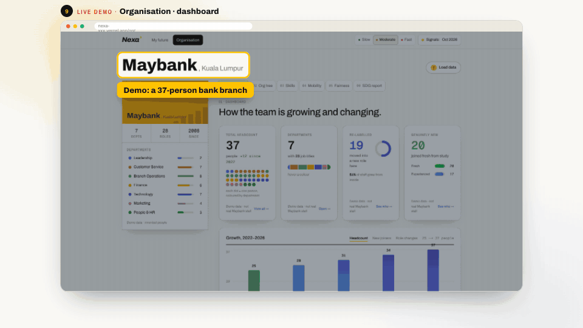</p>

### Key Features

All six must-haves from the Domain 1 brief, plus the good-to-haves:

- **Skills profile intake** — CV upload (PDF / Word), short form or sample person; every skill confirmed by the person.
- **AI-trend signal layer** — Task X-ray from measured AI use per task; Skills Radar with Skill Momentum; live arXiv and OpenDOSM refresh; every number dated.
- **Future-role matching** — 21 cited roles, an explainable four-part score and a skills-gap breakdown.
- **Personalised reskilling pathway** — prerequisites first, week-by-week, real link-checked courses, HRD Corp route.
- **SDG mapping** — every role and skill tagged to UN targets; the Impact Compass re-ranks by the Goals a person cares about.
- **Handling uncertainty** — slow / moderate / fast futures, ranges instead of single numbers, "safe in all 3" badge.
- **Organisation view** — dashboard, org tree, person stories, skills heatmap, cohorts, mobility, fairness check, SDG report, CSV upload.
- **Automatic re-planning** — "What changed" when the evidence moves; mobile-friendly, accessible design.

<table>
<tr>
<td width="50%">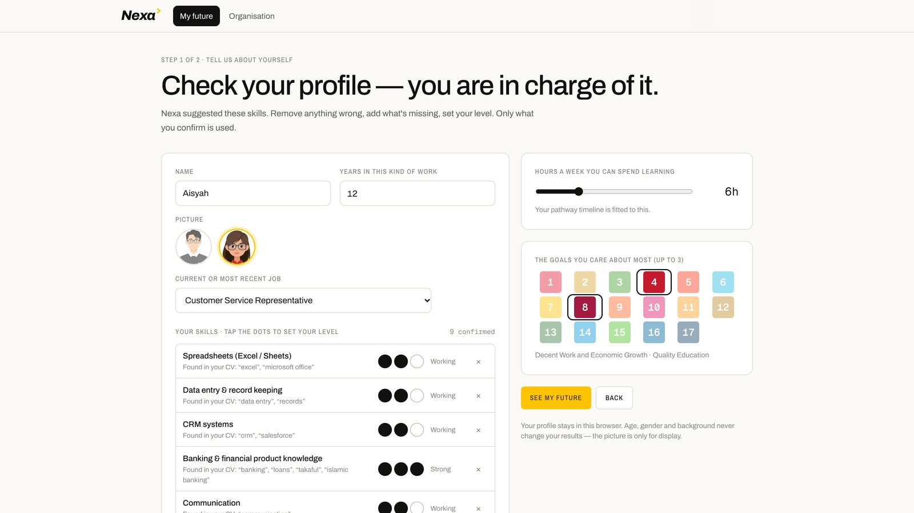<br/><sub><b>Start</b>: check your profile, you are in charge of it</sub></td>
<td width="50%"><br/><sub><b>Task X-ray</b>: what AI means for her job today</sub></td>
</tr>
<tr>
<td>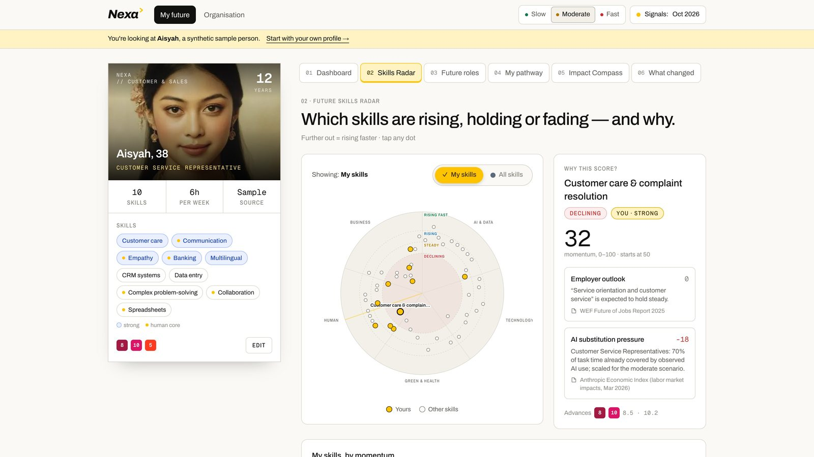<br/><sub><b>Skills Radar</b>: rising, holding or fading, and why</sub></td>
<td>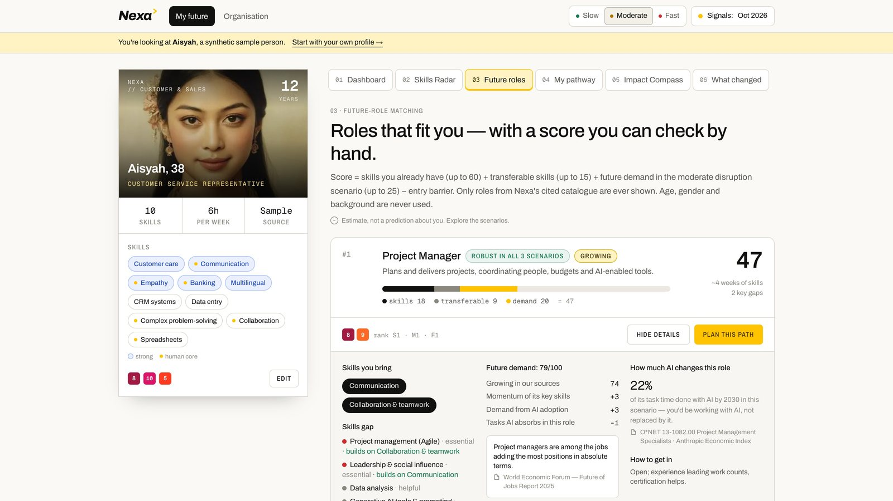<br/><sub><b>Future roles</b>: a score you can check by hand</sub></td>
</tr>
<tr>
<td>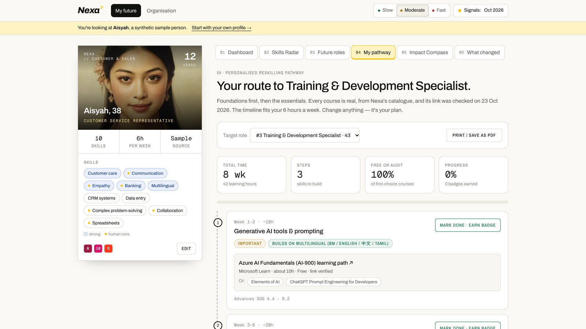<br/><sub><b>Pathway</b>: real courses, timed to her week</sub></td>
<td>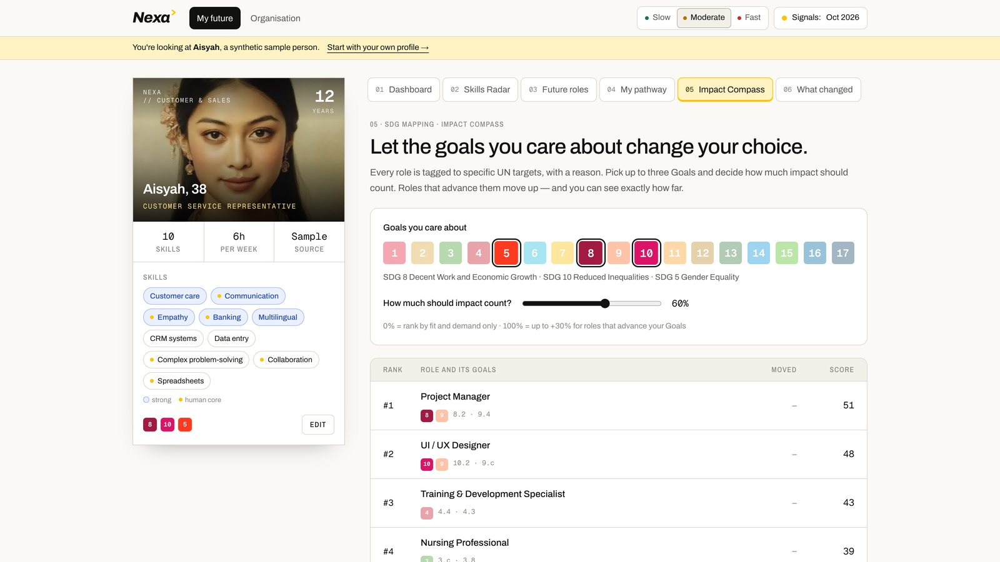<br/><sub><b>Impact Compass</b>: the Goals she cares about re-rank roles</sub></td>
</tr>
<tr>
<td><br/><sub><b>Organisation</b>: how the team is growing and changing</sub></td>
<td>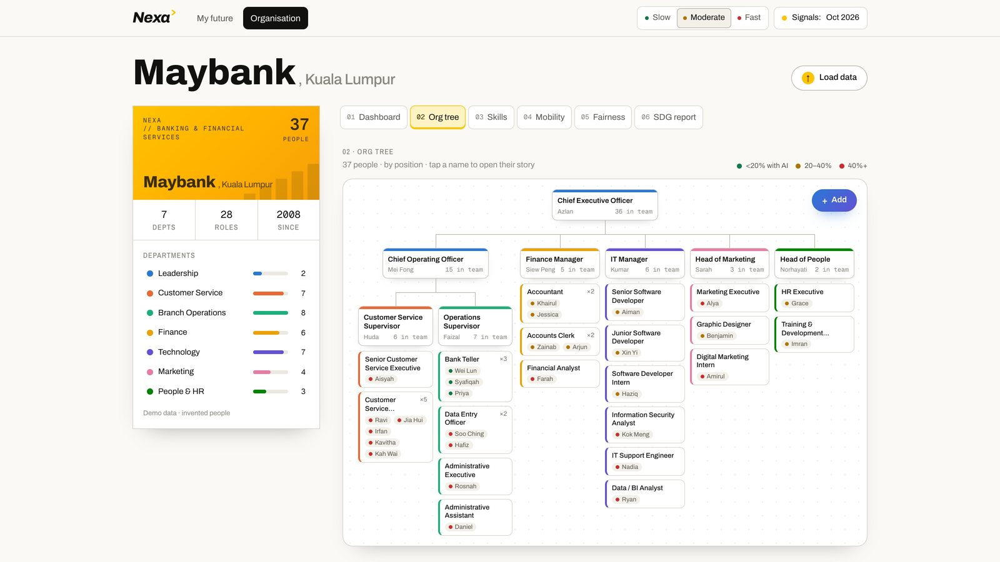<br/><sub><b>Org tree</b>: all 37 positions, roles first, names second</sub></td>
</tr>
<tr>
<td>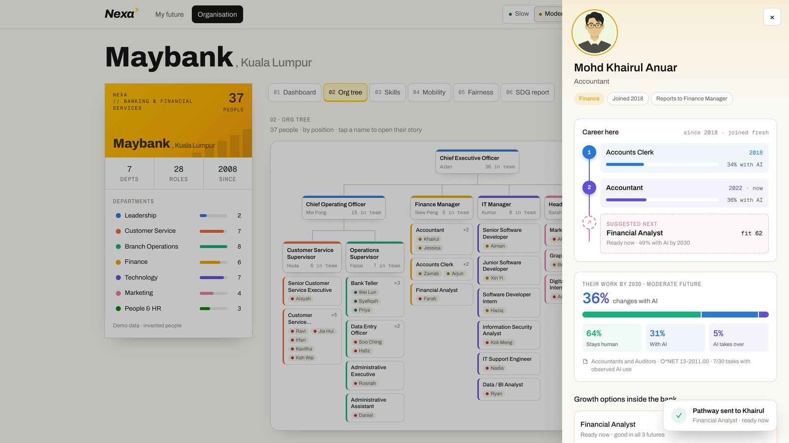<br/><sub><b>One person's story</b>: career, AI change, next role</sub></td>
<td>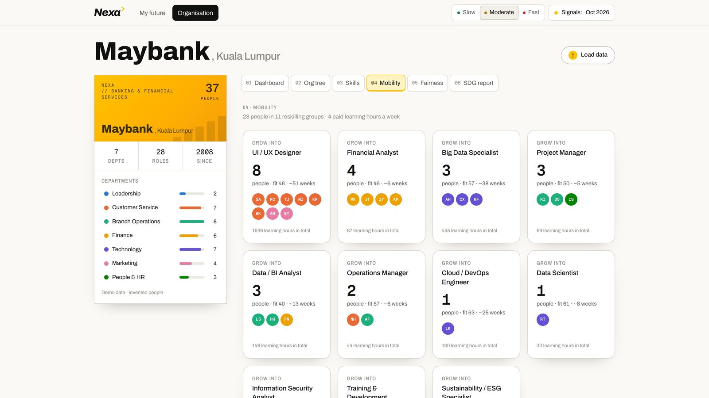<br/><sub><b>Mobility</b>: reskilling groups by target role</sub></td>
</tr>
<tr>
<td>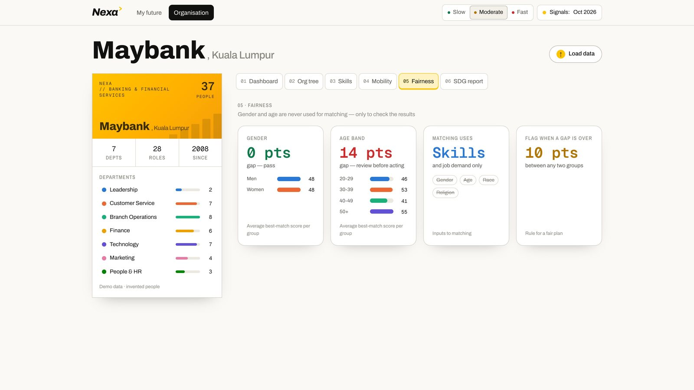<br/><sub><b>Fairness</b>: gender and age gaps checked</sub></td>
<td>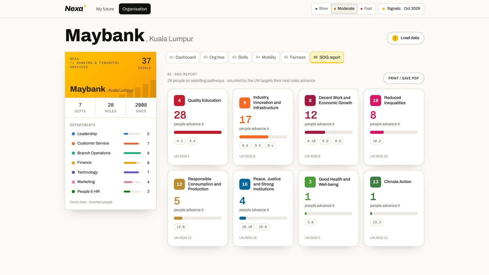<br/><sub><b>SDG report</b>: people advanced per Goal</sub></td>
</tr>
</table>

### Tech Stack

| Layer | Technology |
| --- | --- |
| Frontend | Next.js 16 (App Router), React 19, Tailwind CSS 4, Motion |
| Backend | Next.js route handlers in TypeScript (Node.js): `/api/parse-cv`, `/api/arxiv`, `/api/labour`, `/api/semantic` |
| Database | No personal-data database: versioned JSON datasets built from public sources; profiles stay in the browser |
| AI / Compute | **RunPod** (GPU, serverless): BAAI/bge-small-en-v1.5 embeddings · deterministic, explainable scoring engine · optional Claude API for CV reading |
| Hosting / Dev | **Vercel** (live app, auto-deploy from GitHub) · **Replit** (ideation, pitch deck) · GitHub |

**Data sources:** O\*NET 31.0 (CC BY 4.0), Anthropic Economic Index (CC BY),
arXiv API, OpenDOSM, WEF Future of Jobs 2025, TalentCorp Impact Study 2024,
HRD Corp, UN SDGs. Every sample person and the 37-person demo organisation are
**synthetic**; photos are the team's own. Full list with dates in the app at
[`/evidence`](https://nexa-xxx.vercel.app/evidence) and in the
[Tech Declaration](submission/SDC2026_EcoByte_TechDeclaration.pdf).

---

## 📁 Project Structure

```
.
├── app/                      # Pages: / · /start · /me · /org · /evidence
│   └── api/                  # parse-cv · arxiv · labour · semantic (RunPod proxy)
├── components/               # landing · intake · personal dashboard · organisation view
├── lib/
│   ├── engine/               # scenarios · momentum · match · pathway · org analytics · changes
│   ├── signals/              # arXiv + OpenDOSM fetchers and dated snapshots
│   └── cv/                   # CV reading: keyword matcher + optional Claude extractor
├── data/
│   ├── curated/              # roles · skills · courses · SDG targets · synthetic people & org
│   ├── occupation-tasks.json # built from O*NET + Anthropic Economic Index
│   └── signals.json          # dated, real trend readings
├── docs/                     # Screenshots, GIFs, diagrams, pitch deck PDF
├── public/                   # Logo, avatars, sample-person photos
├── runpod/
│   ├── handler.py            # RunPod serverless handler (GPU workload)
│   ├── Dockerfile
│   └── requirements.txt
├── scripts/                  # data build, signal snapshots, course-link check
├── submission/               # Required submission documents
│   ├── SDC2026_EcoByte_Preliminary.pdf       # Preliminary submission
│   ├── SDC2026_EcoByte_TechDeclaration.pdf   # Technology declaration
│   ├── SDC2026_EcoByte_Replit_POU.pdf        # Replit proof of use
│   └── SDC2026_EcoByte_Runpod_POU.pdf        # RunPod proof of use
├── tests/                    # Engine and CV-identity unit tests
├── .env.example              # Example environment variables
├── .gitignore
├── .replit                   # Replit run configuration
├── LICENSE
├── package.json              # Node.js dependencies (web app)
├── requirements.txt          # Python dependencies (RunPod worker)
└── README.md
```

### Architecture

<picture>
  <source media="(prefers-color-scheme: dark)" srcset="docs/diagrams/architecture-dark.png">
  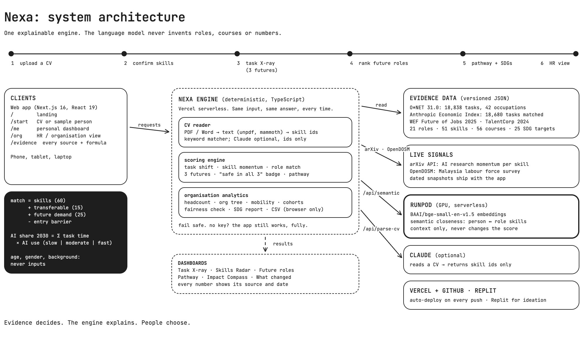
</picture>

The engine is **deterministic**: the same input gives the same answer every
time, and every number on screen carries its **source and date**. The language
model only turns a CV into skill ids from our catalogue; it never produces
roles, courses or numbers. Every external service is **optional**: without
keys, Nexa still runs end to end.

<picture>
  <source media="(prefers-color-scheme: dark)" srcset="docs/diagrams/engine-dark.png">
  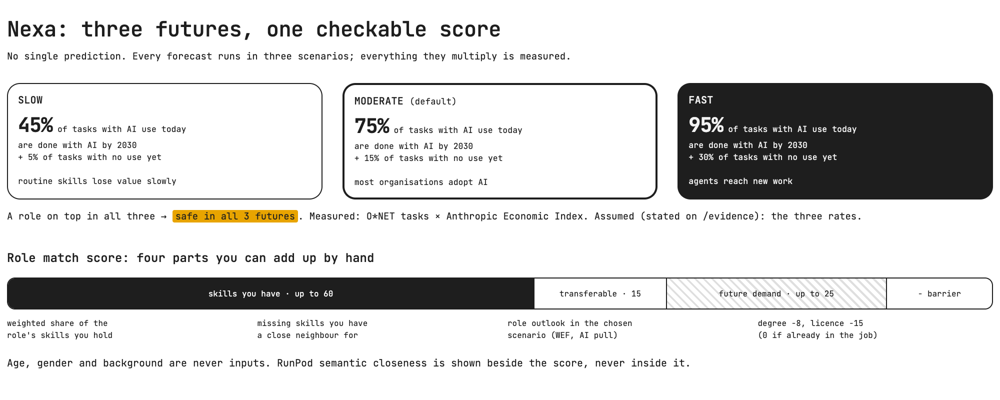
</picture>

---

## 🚀 How to Run

### Option 1 — Run on Replit

1. In Replit, **Create Repl → Import from GitHub** and paste `https://github.com/eyahia1712/Nexa`.
2. Optional: open the **Secrets** tab (🔒) and add the variables from `.env.example`:
   - `RUNPOD_API_KEY`
   - `RUNPOD_ENDPOINT_ID`
   - `ANTHROPIC_API_KEY`
3. Click **Run**. Replit uses the `.replit` file to run `npm run dev` on port 3000.

### Option 2 — Run Locally

```bash
# 1. Clone the repository
git clone https://github.com/eyahia1712/Nexa.git
cd Nexa

# 2. Install dependencies (Node.js 20+)
npm install

# 3. Configure environment variables (optional, Nexa runs without them)
cp .env.example .env.local

# 4. Run the app
npm run dev                  # http://localhost:3000
```

### Option 3 — Deploy on Vercel (how the live demo runs)

1. In Vercel, **Add New → Project** and import this repository.
2. Optional: add the variables from `.env.example` under **Settings → Environment Variables**.
3. Click **Deploy**. Every push to `main` redeploys automatically.

### Run Tests

```bash
npm test              # engine and CV-identity tests
npm run typecheck
npm run lint
```

---

## 🟠 How We Use Replit *(Required)*

- **Ideation:** the team used Replit Agent (Replit Core credits) to research and compare six project ideas before choosing Nexa
- **Pitch deck:** the editable pitch deck was redesigned in Replit
- **Runnable on Replit:** the `.replit` file lets anyone import and run Nexa on Replit
- **Secrets:** API keys live in Replit Secrets or environment variables, never in the code

📄 Proof of use: [`submission/SDC2026_EcoByte_Replit_POU.pdf`](submission/SDC2026_EcoByte_Replit_POU.pdf)

## 🟣 How We Use RunPod *(Required)*

- **Workload:** semantic skill closeness. The open-source embedding model **BAAI/bge-small-en-v1.5** runs on a RunPod GPU and measures how close, in meaning, a person's skills are to each target role's skills
- **Setup:** [`runpod/handler.py`](runpod/handler.py) with its [`Dockerfile`](runpod/Dockerfile) is deployed as a **RunPod Serverless Endpoint**; the model is baked into the image
- **Integration:** the app calls the endpoint through `/api/semantic` using `RUNPOD_API_KEY` and `RUNPOD_ENDPOINT_ID`, kept on the server. The result appears as **semantic closeness** beside each role and **never changes the explainable score**

Example request:

```bash
curl -X POST https://api.runpod.ai/v2/$RUNPOD_ENDPOINT_ID/runsync \
  -H "Authorization: Bearer $RUNPOD_API_KEY" \
  -H "Content-Type: application/json" \
  -d '{"input": {"profile": ["Customer care", "Empathy"], "roles": {"training_specialist": ["Instructional design", "Communication"]}}}'
```

📄 Proof of use: [`submission/SDC2026_EcoByte_Runpod_POU.pdf`](submission/SDC2026_EcoByte_Runpod_POU.pdf)

---

## 🧗 Challenges & Learnings

- **Trustworthy forecasts without invented numbers.** We chose task-level evidence (O\*NET × Anthropic Economic Index) over asking a language model to guess, and kept every score deterministic and explainable.
- **Uncertainty.** Instead of one prediction, every forecast runs in three scenarios with ranges; roles that hold up in all three are marked safe.
- **Stale data.** arXiv and OpenDOSM are queried live, and dated readings ship with the app, so every number shows its date.
- **Responsible HR use.** The organisation view is built for growth, the employee decides on any pathway, and a fairness check runs across gender and age.

## 🔭 Future Improvements

- [ ] Map occupations to MASCO, Malaysia's occupation classification
- [ ] Add Malaysian job-posting data as a demand signal
- [ ] Full Bahasa Malaysia and Chinese interface
- [ ] Employer-verified HRD Corp course codes
- [ ] Notifications when a person's pathway changes

## 👥 Team

| Name | Role | GitHub |
| --- | --- | --- |
| Eya Hia | Team Leader & Lead Developer | [@eyahia1712](https://github.com/eyahia1712) |
| Ng Wei Meng | Lead Researcher & Data | |
| Alya Maisarah binti Jaafad Sadiq | Presenter & Pitch Lead | |
| Mohamad Khairul Haiqal bin Mohamad Razali | QA & Submission Lead | [@redberrysss](https://github.com/redberrysss) |

---

## ✅ Submission Checklist

- [x] Team name, domain (Domain 1) and SDG track filled in
- [x] Slide deck link added
- [x] Demo video link added
- [x] Replit used, with proof of use in `submission/`
- [x] RunPod used, with proof of use in `submission/`
- [x] Preliminary submission completed (`SDC2026_EcoByte_Preliminary.pdf`)
- [x] Technology declaration completed (`SDC2026_EcoByte_TechDeclaration.pdf`)
- [x] Submission files renamed with our team name
- [x] "How to Run" steps verified
- [x] No API keys or secrets committed to the repository

## 📜 License

This project is licensed under the [Apache License 2.0](LICENSE).
