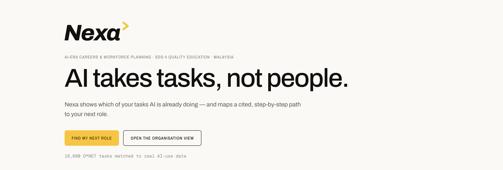
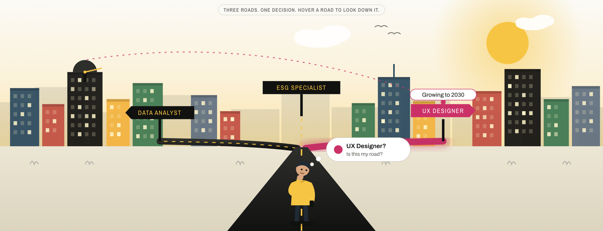
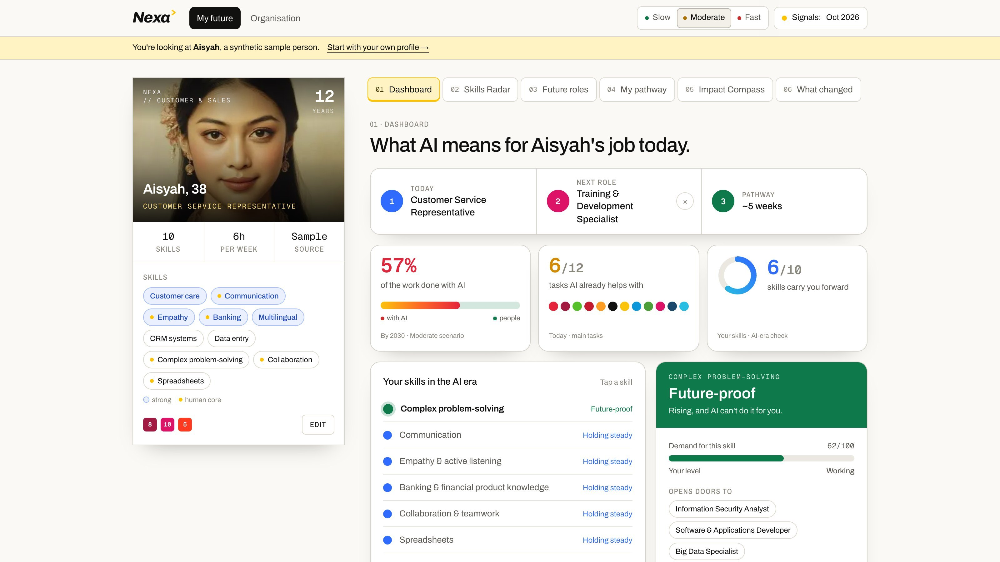
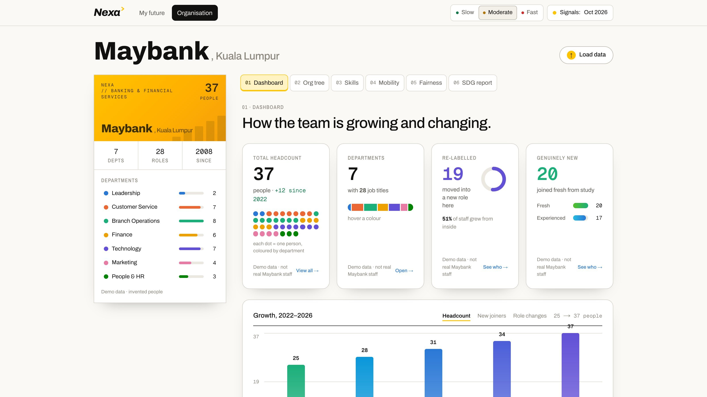
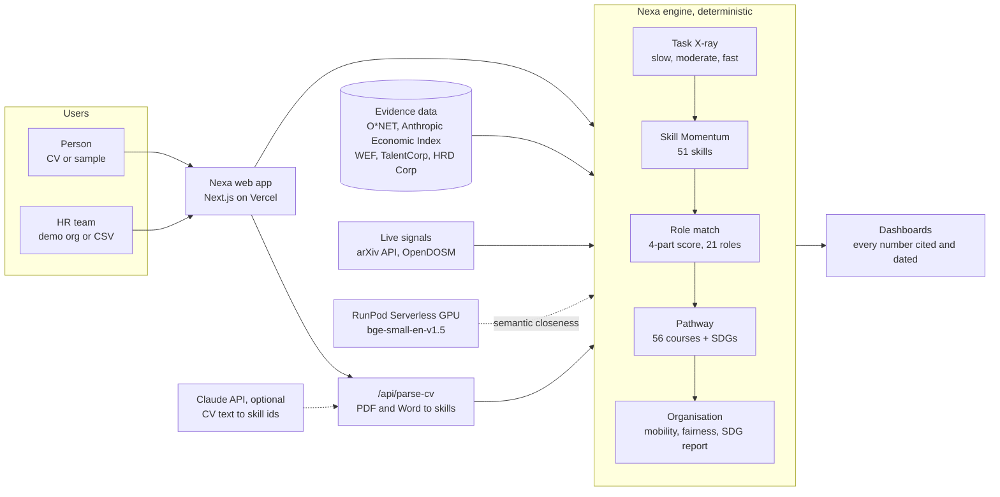

#  Nexa

AI takes tasks, not people.

**Nexa forecasts at the level of tasks, not job titles, in three possible
futures, with every number cited and dated, and maps every pathway to the UN
Sustainable Development Goals.**





*Three roads, one decision. Nexa shows a person which of their tasks AI is
already doing, and a cited, step-by-step path down the road that fits them.*

---

## 📋 Team Information

| Field | Details |
|---|---|
| **Team Name** | EcoByte |
| **Team Domain** | Domain 1 — Aiversecity Future-Ready Workforce |
| **SDG Track (1–17)** | SDG 4 — Quality Education (Target 4.4), with SDG 5, 8, 9 and 10 |
| **Team Leader** | Eya Hia |
| **University** | Lincoln University College · UKM · UTM · Universiti Malaysia Kelantan |
| **Number of Members** | 4 |

## 🔗 Links

| Resource | Link |
|---|---|
| 💻 **GitHub Repository** | **[github.com/eyahia1712/Nexa](https://github.com/eyahia1712/Nexa)** |
| 🟠 **Replit Project** | **[Replit proof of use (PDF)](submission/SDC2026_EcoByte_Replit_POU.pdf)** |
| 🌐 **Live Demo** | **[nexa-xxx.vercel.app](https://nexa-xxx.vercel.app/)** |
| 🟣 **RunPod Endpoint** | **[RunPod proof of use (PDF)](submission/SDC2026_EcoByte_Runpod_POU.pdf)** |
| 📄 **Slide Deck** | **[Nexa pitch deck](https://drive.google.com/file/d/1aasnv7n8EIVwiowdyzulz0QttzTl282e/view?usp=sharing)** |
| 🎬 **Demo Video** | **[Watch the pitch video](https://youtu.be/dp5byv_Zbzo)** |

---

## 💡 Overview

### Problem

AI is changing Malaysian work one task at a time, and almost nobody gets a
personal answer about what that means for them.

- **The training gap is huge.** 56% of Malaysian professionals already use AI
  at work, but only 26% have been trained for it (Hays Asia Salary Guide 2025).
- **The scale is national.** More than 600,000 Malaysian workers need
  reskilling in the next three to five years (MOSTI, cited in the SDC brief).
- **Forecasts talk about job titles, but AI takes over tasks.** So a customer
  service worker reads the headlines and still can't tell which of their own
  tasks are changing, or what to learn next.
- **HR plans with spreadsheets and guesswork.** Who to reskill, into what, how
  long it takes, and whether it is fair are answered by gut feeling.

**Everyone can see the storm coming. Nobody has a personal forecast, or a road out.**

### Solution

#### 📄 1. Upload a CV

- PDF or Word, a short form, or a synthetic sample person
- Nexa reads the name, job and skills; **the person confirms every skill**
- No account, no database: the profile stays in the browser

**The person is in charge of their profile from the first second.**

---

#### 🔬 2. See which tasks AI is already doing

- The job is broken into its official **O\*NET tasks**
- Each task is checked against **measured real-world AI use** (Anthropic
  Economic Index, 18,680 tasks matched)
- The result is a range, not a guess: *57% of Aisyah's working time is done
  with AI by 2030*, and a clear verdict for every skill

**Forecasts at the level of tasks, not job titles.**

---

#### 📡 3. Know which skills are rising

- **51 skills** scored by Skill Momentum, from WEF Future of Jobs 2025, live
  arXiv research growth and AI substitution pressure
- Tap any skill and the **"Why?" panel** shows every point and its source

**Every score is explained.**

---

#### 🎯 4. Rank future roles, in three futures

- **21 cited roles**, each with a score you can **add up by hand**: skills you
  have + transferable + future demand − entry barrier
- Every forecast runs in **slow, moderate and fast** futures; roles on top in
  all three are marked **safe in all 3 futures**

**No single prediction. No black box.**

---

#### 🛣️ 5. Get a pathway you can start today

- A week-by-week plan timed to the hours a person has (*6 hours a week, about
  5 weeks*)
- **56 real, link-checked courses**, free or claimable through **HRD Corp**
- The **Impact Compass** re-ranks roles by the SDGs a person cares about

**Nothing invented: no made-up jobs, courses or numbers.**

---

#### 🔄 6. When the evidence moves, the plan moves

- **arXiv** and **OpenDOSM** are read live; dated readings ship with the app
- **What changed** explains which roles moved, and why

**A plan that ages with the evidence, not against it.**

---

#### 🏢 7. Give HR the whole workforce on one screen

- A 37-person bank branch in demo data: headcount, departments, who grew into a
  new role, who joined fresh
- Org tree, each person's career story, team skills, reskilling cohorts,
  internal mobility, a **fairness check** across gender and age, and an **SDG
  report**
- HR can add people or load its own CSV, which never leaves the browser

**HR offers the pathway. The employee decides.**

### Key Features

- **Skills profile intake** — CV upload, short form or sample person; every skill confirmed by the person
- **Task X-ray** — the share of a person's task time done with AI by 2030, from measured AI use per task
- **Skills Radar** — 51 skills ranked by momentum, every point sourced
- **Future roles** — 21 cited roles, an explainable four-part score and the exact skills gap
- **Three futures** — slow, moderate and fast, with ranges and a "safe in all 3" badge
- **Reskilling pathway** — prerequisites first, week by week, real link-checked courses, HRD Corp route
- **SDG mapping** — every role and skill tagged to UN targets; the Impact Compass re-ranks by the Goals you care about
- **Organisation view** — dashboard, org tree, person stories, skills, mobility, fairness check, SDG report, CSV upload



*The personal dashboard: today's job, the next role and the pathway at the top;
57% of her work done with AI by 2030; and a verdict for every skill.*



*The organisation view: 37 people, 7 departments, 19 who grew into a new role,
20 who joined fresh, and how the team grew since 2022. Demo data, invented
staff.*

### Tech Stack

| Layer | Technology | Why |
|---|---|---|
| Frontend | Next.js 16, React 19, Tailwind CSS 4, Motion | One fast, mobile-friendly app |
| Backend | Next.js route handlers in TypeScript | `/api/parse-cv`, `/api/arxiv`, `/api/labour`, `/api/semantic` |
| Database | Versioned JSON from public datasets; no personal-data database | Every number reproducible; profiles stay in the browser |
| AI / Compute | **RunPod** GPU (BAAI/bge-small-en-v1.5) · deterministic scoring engine · optional Claude for CV reading | Explainable first; AI only where it adds evidence |
| Hosting / Dev | **Vercel** (live, auto-deploy) · **Replit** (ideation, pitch deck) · GitHub | Zero-setup deployment |

**Data:** O\*NET 31.0, Anthropic Economic Index, WEF Future of Jobs 2025,
TalentCorp, arXiv, OpenDOSM, HRD Corp and the UN SDGs. Every sample person and
the demo organisation are synthetic. Full list in the app at
[`/evidence`](https://nexa-xxx.vercel.app/evidence) and in the
[Tech Declaration](submission/SDC2026_EcoByte_TechDeclaration.pdf).

---

## 📁 Project Structure

```
.
├── app/                      # Pages: / · /start · /me · /org · /evidence
│   └── api/                  # parse-cv · arxiv · labour · semantic (RunPod)
├── components/               # Landing, intake, personal dashboard, organisation view
├── lib/
│   ├── engine/               # Scenarios, momentum, matching, pathway, org analytics
│   ├── signals/              # arXiv + OpenDOSM readings
│   └── cv/                   # CV reading
├── data/                     # Curated roles, skills, courses, SDGs, synthetic people
├── docs/                     # Screenshots
├── public/                   # Logo and photos
├── runpod/
│   └── handler.py            # RunPod serverless handler (GPU workload)
├── scripts/                  # Data build and course-link check
├── submission/               # Required submission documents
│   ├── SDC2026_EcoByte_Preliminary.pdf      # Preliminary submission
│   ├── SDC2026_EcoByte_TechDeclaration.pdf  # Technology declaration
│   ├── SDC2026_EcoByte_Replit_POU.pdf       # Replit proof of use
│   └── SDC2026_EcoByte_Runpod_POU.pdf       # RunPod proof of use
├── tests/                    # Unit tests
├── .env.example              # Example environment variables
├── .gitignore
├── .replit                   # Replit run configuration
├── LICENSE
├── package.json              # Node.js dependencies
├── requirements.txt          # Python dependencies (RunPod worker)
└── README.md
```

### Architecture



- **Engine** (`lib/engine/`) — plain TypeScript. Same input, same answer, every
  time. The language model never produces a role, a course or a number.
- **Evidence** (`data/`) — versioned JSON built from public datasets, so every
  figure on screen carries its source and date.
- **Live signals** (`lib/signals/`) — arXiv and OpenDOSM are read live, with
  dated snapshots as a fallback.
- **RunPod** (`runpod/`) — a GPU embedding model adds semantic closeness beside
  each role. It is context only and never changes the score.
- **Optional by design** — without any key, Nexa still runs end to end.

---

## 🚀 How to Run

### Option 1 — Run on Replit

1. In Replit, **Create Repl → Import from GitHub** and paste `https://github.com/eyahia1712/Nexa`.
2. Optional: open the **Secrets** tab (🔒) and add the variables from `.env.example`:
   - `RUNPOD_API_KEY`
   - `RUNPOD_ENDPOINT_ID`
   - `ANTHROPIC_API_KEY`
3. Click **Run**. Replit uses the `.replit` file to start the app on port 3000.

### Option 2 — Run Locally

```bash
git clone https://github.com/eyahia1712/Nexa.git
cd Nexa
npm install                  # Node.js 20+
cp .env.example .env.local   # optional keys; Nexa runs without them
npm run dev                  # http://localhost:3000
```

### Run Tests

```bash
npm test
```

---

## 🟠 How We Use Replit *(Required)*

- **Ideation:** Replit Agent helped us research and compare six project ideas before we chose Nexa
- **Pitch deck:** our editable pitch deck was redesigned in Replit
- **Runnable:** the `.replit` file lets anyone import and run Nexa on Replit
- **Secrets:** API keys live in Replit Secrets or environment variables, never in the code

📄 Proof of use: [`submission/SDC2026_EcoByte_Replit_POU.pdf`](submission/SDC2026_EcoByte_Replit_POU.pdf)

## 🟣 How We Use RunPod *(Required)*

- **Workload:** semantic skill closeness. The open-source embedding model **BAAI/bge-small-en-v1.5** runs on a RunPod GPU and measures how close, in meaning, a person's skills are to each role's skills
- **Setup:** [`runpod/handler.py`](runpod/handler.py) is deployed as a **RunPod Serverless Endpoint**
- **Integration:** the app calls the endpoint through `/api/semantic` using `RUNPOD_API_KEY` and `RUNPOD_ENDPOINT_ID`, kept on the server

Example request:

```bash
curl -X POST https://api.runpod.ai/v2/$RUNPOD_ENDPOINT_ID/runsync \
  -H "Authorization: Bearer $RUNPOD_API_KEY" \
  -H "Content-Type: application/json" \
  -d '{"input": {"profile": ["Customer care", "Empathy"], "roles": {"training_specialist": ["Instructional design", "Communication"]}}}'
```

📄 Proof of use: [`submission/SDC2026_EcoByte_Runpod_POU.pdf`](submission/SDC2026_EcoByte_Runpod_POU.pdf)

---

## 🧗 Challenges & Learnings

- **Trustworthy forecasts without invented numbers.** We used task-level evidence (O\*NET × Anthropic Economic Index) instead of asking a language model to guess, and kept every score explainable.
- **Uncertainty.** One prediction would be false confidence, so every forecast runs in three futures with ranges.
- **Stale data.** arXiv and OpenDOSM are read live, and every number shows its date.
- **Responsible HR use.** The organisation view is built for growth: the employee decides on any pathway, and a fairness check runs across gender and age.

## 🔭 Future Improvements

- [ ] Map occupations to MASCO, Malaysia's occupation classification
- [ ] Add Malaysian job-posting data as a demand signal
- [ ] Full Bahasa Malaysia and Chinese interface
- [ ] Employer-verified HRD Corp course codes
- [ ] Notifications when a person's pathway changes

## 👥 Team

| Name | Role | GitHub |
|---|---|---|
| **Eya Hia** | Team Leader & Lead Developer | [@eyahia1712](https://github.com/eyahia1712) |
| **Ng Wei Meng** | Lead Researcher & Data | [@DrNWM](https://github.com/DrNWM) |
| **Alya Maisarah binti Jaafad Sadiq** | Presenter & Pitch Lead | |
| **Mohamad Khairul Haiqal bin Mohamad Razali** | QA & Submission Lead | [@redberrysss](https://github.com/redberrysss) |

---

## ✅ Submission Checklist

- [x] Team name, domain (Domain 1) and SDG track filled in
- [x] Slide deck link added
- [x] Demo video link added
- [x] Replit used, with proof of use in `submission/`
- [x] RunPod used, with proof of use in `submission/`
- [x] Preliminary submission completed (`SDC2026_EcoByte_Preliminary.pdf`)
- [x] Technology declaration completed (`SDC2026_EcoByte_TechDeclaration.pdf`)
- [x] Submission files renamed with our team name
- [x] "How to Run" steps verified
- [x] No API keys or secrets committed to the repository

## 📜 License

This project is licensed under the [Apache License 2.0](LICENSE).

---

*Nexa · Team EcoByte · SDC Hackathon 2026*
