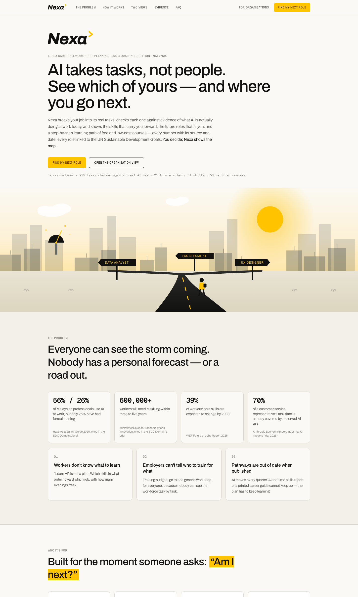

# Nexa

> AI takes tasks, not people. Nexa shows workers, graduates and organisations which tasks AI is already doing, which skills carry them forward, and a cited, step-by-step path to a future role — linked to the UN Sustainable Development Goals.



---

## Team Information

| Field                 | Details                                                                                     |
| --------------------- | ------------------------------------------------------------------------------------------- |
| **Team Name**         | EcoByte                                                                                     |
| **Team Domain**       | Domain 1 — Aiversecity Future-Ready Workforce                                               |
| **SDG Track (1–17)**  | SDG 4 — Quality Education (with SDG 5, 8, 9, 10)                                            |
| **Team Leader**       | Eya Hia                                                                                     |
| **University**        | Lincoln University College · UKM · UTM · Universiti Malaysia Kelantan                       |
| **Number of Members** | 4                                                                                           |

## Links

| Resource          | Link                                       |
| ----------------- | ------------------------------------------ |
| GitHub Repository | https://github.com/eyahia1712/Nexa          |
| Replit Proof      | `submission/SDC2026_EcoByte_Replit_POU.pdf` |
| Live Demo         | _TODO: add Vercel URL_                     |
| RunPod Endpoint   | _TODO: add endpoint URL (or "not used")_   |
| Slide Deck        | _TODO: add slide deck link_                |
| Demo Video        | _TODO: add YouTube link (5–7 min)_         |

---

## Overview

### Problem

56% of Malaysian professionals already use AI at work, but only 26% have had formal training (Hays Asia Salary Guide 2025), and more than 600,000 workers will need reskilling within three to five years (MOSTI). Workers don't know which AI-era skills to learn, employers can't tell who to train for what, and learning pathways are out of date by the time they are published — because AI moves every quarter.

### Solution

Nexa forecasts at the level of **tasks**, not job titles. It breaks a job into its official O\*NET tasks, checks each one against measured real-world AI use (Anthropic Economic Index), and shows what share of a person's task time is likely to be done with AI by 2030 under three scenarios. From there it ranks future roles with a score anyone can add up by hand, builds a personalised pathway of real, link-checked free and low-cost courses, and lets SDG priorities visibly change the ranking. Trend signals (arXiv research volume, Malaysia's labour force survey) are refreshable live, and Nexa explains what changed in the plan and why. The same engine powers an organisation view for HR.

### Key Features

All six must-haves from the Domain 1 brief, plus all six good-to-haves:

- **Skills profile intake** — upload a CV (PDF / DOCX / text), answer a short form, or pick a synthetic sample person; every skill is confirmed by the person.
- **AI-trend signal layer** — Task X-Ray from measured AI use per task; Future Skills Radar with Skill Momentum built from WEF 2025, live arXiv research growth and AI substitution pressure; every number shows its source and date; "Refresh signals" queries arXiv and OpenDOSM live.
- **Future-role matching** — ranked roles from a cited catalogue with an explainable score (skills + transferable + demand − entry barrier) and a skills-gap breakdown.
- **Personalised reskilling pathway** — prerequisites first, week-by-week timeline fitted to the person's hours, real courses with verified links, HRD Corp route for employers.
- **SDG mapping** — every role and skill tagged to specific UN targets with a reason; the Impact Compass re-ranks roles by the Goals a person cares about.
- **Handling uncertainty** — slow / moderate / fast disruption everywhere, ranges instead of single numbers, "robust in all 3 scenarios" badge.
- **Good-to-haves** — HR / organisation view (org tree, role outlook tree, skills heatmap, reskilling cohorts, talent mobility), automatic re-planning ("What changed"), fairness check, progress tracking and badges, SDG contribution views, accessible mobile-friendly design.

### Tech Stack

| Layer         | Technology                                                                 |
| ------------- | -------------------------------------------------------------------------- |
| Frontend      | Next.js 16 (App Router), React 19, Tailwind CSS 4                          |
| Backend       | Next.js route handlers (TypeScript, Node.js)                               |
| Database      | Versioned JSON data files built from public datasets (no personal data stored) |
| AI / Compute  | Deterministic scoring engine · optional Claude (`claude-opus-5-5`) CV reading · optional RunPod GPU semantic similarity (BAAI/bge-small-en-v1.5) |
| Hosting       | Vercel (auto-deploys every push to GitHub)                                 |
| Ideation      | Replit (ideas, slide and video drafts)                                     |

---

## Project Structure

```
.
├── app/                     # Pages (/, /start, /me, /org, /evidence) and API routes
│   └── api/                 # parse-cv · signals (live refresh) · semantic (RunPod proxy)
├── components/              # UI: landing, intake, individual dashboard, organisation view
├── lib/
│   ├── engine/              # Scenarios, skill momentum, matching, pathway, org analytics
│   ├── signals/             # arXiv + OpenDOSM fetchers and dated snapshots
│   └── cv/                  # CV reading: keyword matcher + optional Claude extractor
├── data/
│   ├── curated/             # Roles, skills, courses, SDG targets, synthetic personas & org
│   ├── occupation-tasks.json# Built from O*NET + Anthropic Economic Index
│   ├── signals.json         # Two dated, real trend readings
│   └── link-check.json      # Last course-link verification
├── docs/                    # Screenshots, architecture
├── runpod/
│   └── handler.py           # RunPod serverless handler (GPU workload)
├── scripts/                 # fetch_data.sh, build_data.py, snapshot-signals.ts, check_links.py
├── submission/              # Required submission documents
│   ├── SDC2026_EcoByte_Preliminary.pdf
│   ├── SDC2026_EcoByte_TechDeclaration.pdf
│   ├── SDC2026_EcoByte_Replit_POU.pdf
│   └── SDC2026_EcoByte_Runpod_POU.pdf
├── tests/                   # Engine and catalogue-integrity tests
├── .env.example
├── .gitignore
├── .replit
├── LICENSE
├── package.json
└── README.md
```

### Architecture

```
 Person / HR ──► Nexa web app (Next.js, hosted on Vercel)
                    │
      ┌─────────────┼──────────────────────────┬───────────────────────────┐
      ▼             ▼                          ▼                           ▼
 Evidence data   Scoring engine            Live signals                Optional AI
 O*NET 31.0      task shift · momentum     arXiv API (research)        Claude: CV → skill ids
 Anthropic       matching · pathway        OpenDOSM (labour force)     RunPod GPU: semantic
 Economic Index  org analytics · fairness  → dated snapshots + live   skill closeness
 WEF · TalentCorp (deterministic, cited)
```

Every recommendation comes from the curated catalogue; the language model never produces roles, courses or numbers. See `/evidence` in the app for every source, formula and assumption.

---

## How to Run

### Option 1 — Deploy on Vercel (Recommended)

1. In Vercel, **Add New → Project** and import this GitHub repository (it is detected as one Next.js app; `vercel.json` and `.vercelignore` keep the RunPod folder out).
2. Optional: under **Settings → Environment Variables**, add any variables from `.env.example` (`ANTHROPIC_API_KEY`, `RUNPOD_API_KEY`, `RUNPOD_ENDPOINT_ID`). Nexa works fully without them.
3. Click **Deploy**. Every push to `main` redeploys automatically.

Live trend readings run from the browser through two small stateless routes (`/api/arxiv`, `/api/labour`), so they work the same on any host.

### Option 2 — Run Locally

```bash
git clone <this-repo-url>
cd nexa
npm install
cp .env.example .env.local   # optional keys
npm run dev                  # http://localhost:3000
```

Requires Node.js 20+.

### Rebuild the data (optional)

```bash
npm run data          # download O*NET + Economic Index, build data/occupation-tasks.json
npm run signals       # take fresh dated arXiv + OpenDOSM readings (≈3 min)
npm run check:links   # re-verify every course link
```

### Run Tests

```bash
npm test              # engine + catalogue-integrity tests
npm run typecheck
npm run lint
```

---

## How We Use Replit *(Required)*

- **Ideation:** The team used Replit (and its AI credits) to brainstorm features, draft designs, and prepare the pitch slides and video.
- **Hosting:** The live app itself is hosted on Vercel (see Live Demo above).
- **Secrets:** API keys are kept in environment variables, never in the code.

📄 Proof of use: [`submission/SDC2026_EcoByte_Replit_POU.pdf`](submission/SDC2026_EcoByte_Replit_POU.pdf)

## How We Use RunPod *(Required)*

- **Workload:** Semantic skill similarity — the open-source embedding model `BAAI/bge-small-en-v1.5` runs on a RunPod GPU and measures how close a person's skills are, in meaning, to each target role's skills.
- **Setup:** `runpod/handler.py` (with `runpod/Dockerfile`) is deployed as a **RunPod Serverless Endpoint**.
- **Integration:** The app calls the endpoint through `/api/semantic` using `RUNPOD_API_KEY` and `RUNPOD_ENDPOINT_ID`; results appear as "semantic closeness" on each role card. It is context only and never changes the explainable score.

Example request:

```bash
curl -X POST https://api.runpod.ai/v2/$RUNPOD_ENDPOINT_ID/runsync \
  -H "Authorization: Bearer $RUNPOD_API_KEY" \
  -H "Content-Type: application/json" \
  -d '{"input": {"profile": ["Customer care", "Empathy"], "roles": {"ux_designer": ["UX research & design", "Empathy"]}}}'
```

📄 Proof of use: [`submission/SDC2026_EcoByte_Runpod_POU.pdf`](submission/SDC2026_EcoByte_Runpod_POU.pdf)

---

## Challenges & Learnings

- **Trustworthy forecasts without inventing numbers.** We chose task-level evidence (O\*NET × Anthropic Economic Index) over asking a language model to guess, and kept every score deterministic and explainable.
- **Uncertainty.** Instead of one prediction, every forecast is shown under three scenarios with ranges, and roles that hold up in all three are marked robust.
- **Updatable signals.** arXiv and OpenDOSM are live; two real dated readings ship with the app so the change can be shown offline.
- **Responsible HR use.** The organisation view is designed for growth (cohorts, internal mobility), with consent-based individual detail and a fairness audit.

## Future Improvements

- [ ] Map occupations to MASCO (Malaysia's occupation classification)
- [ ] Add Malaysian job-posting data as a demand signal
- [ ] Full Bahasa Malaysia and Chinese interface
- [ ] Employer-verified HRD Corp course codes
- [ ] Notifications when a person's pathway changes

## Team

| Name                                         | Role                          | GitHub      |
| -------------------------------------------- | ----------------------------- | ----------- |
| Eya Hia                                      | Team Leader & Lead Developer  | _@TODO_     |
| Ng Wei Meng                                  | Lead Researcher & Data        | _@TODO_     |
| Alya Maisarah binti Jaafad Sadiq             | Presenter & Pitch Lead        | _@TODO_     |
| Mohamad Khairul Haiqal bin Mohamad Razali    | QA & Submission Lead          | _@TODO_     |

## Data & AI Disclosure

- **Data sources:** O\*NET 31.0 (CC BY 4.0), Anthropic Economic Index (CC BY), arXiv API, OpenDOSM, WEF Future of Jobs 2025, TalentCorp Impact Study, UN SDGs. Full list with dates in the app at `/evidence`.
- **Synthetic data only:** all sample people are fictional. The organisation view is labelled "Maybank, Kuala Lumpur" for the demo, but its 37 employees, their names, careers and skills are invented (`data/curated/org-maybank.json`, built by `scripts/build_org_demo.py`) — not real Maybank staff. The landing-page preview uses a separate fictional bank (Teratai Bank Berhad). Organisations can load their own staff from a CSV; it is read and kept in the browser only.
- **AI models:** Claude `claude-opus-5-5` (optional, CV → skill ids only); BAAI/bge-small-en-v1.5 on RunPod (optional, semantic similarity).
- **AI-assisted development:** declared in `submission/SDC2026_EcoByte_TechDeclaration.pdf`.

---

## Submission Checklist

- [x] Team name, domain (Domain 1) and SDG track filled in
- [ ] Slide deck link added
- [ ] Demo video link added
- [ ] Replit used, with proof of use in `submission/`
- [ ] RunPod used, with proof of use in `submission/`
- [ ] Preliminary submission completed (`SDC2026_EcoByte_Preliminary.pdf`)
- [ ] Technology declaration completed (`SDC2026_EcoByte_TechDeclaration.pdf`)
- [x] Submission files named with our team name
- [ ] "How to Run" steps verified on Vercel
- [x] No API keys or secrets committed to the repository

## License

This project is licensed under the [Apache License 2.0](LICENSE).
